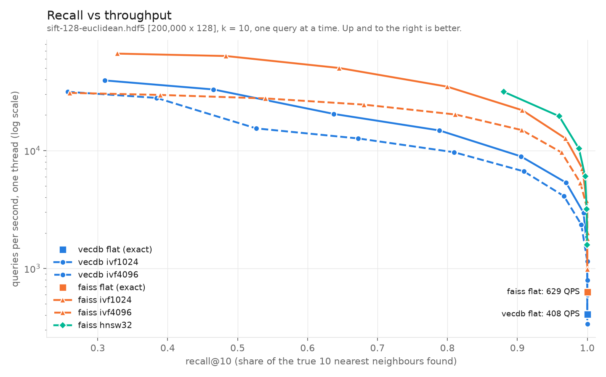
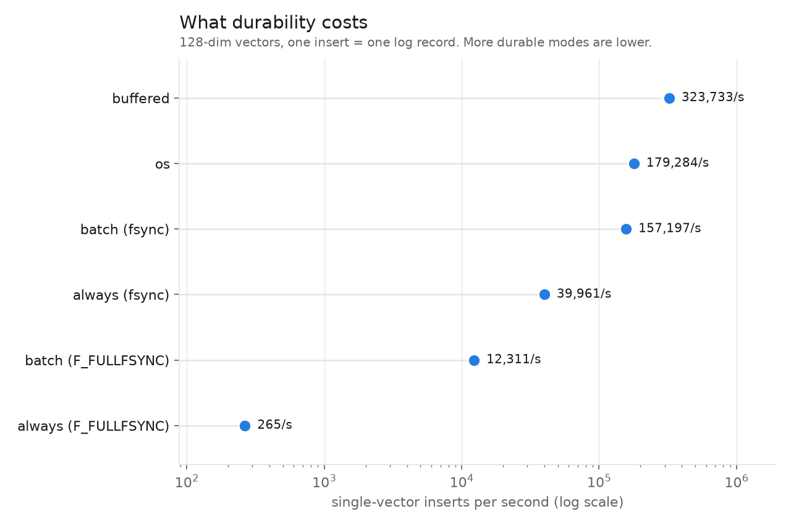
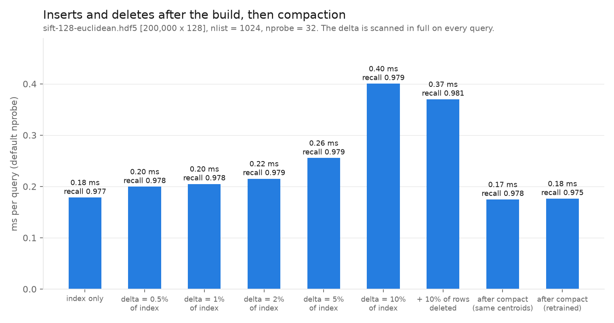

# Results

Machine: macOS-27.2.1-arm64-arm-64bit-Mach-O (arm64), 10 CPUs, Python 3.13.0, NumPy 2.5.5, BLAS accelerate unknown. Query timings use one thread.

## Search (sift-128-euclidean.hdf5 [200,000 x 128])

| system | recall >= 0.90 | recall >= 0.95 | recall >= 0.99 |
|---|---|---|---|
| vecdb flat | 408 QPS (2.45 ms), exact | same | same |
| vecdb ivf1024 | 8,925 QPS (0.11 ms, param 16) | 5,338 QPS (0.19 ms, param 32) | 2,966 QPS (0.34 ms, param 64) |
| vecdb ivf4096 | 6,658 QPS (0.15 ms, param 32) | 4,104 QPS (0.24 ms, param 64) | 2,351 QPS (0.43 ms, param 128) |
| faiss flat | 629 QPS (1.59 ms), exact | same | same |
| faiss ivf1024 | 21,965 QPS (0.05 ms, param 16) | 12,638 QPS (0.08 ms, param 32) | 7,012 QPS (0.14 ms, param 64) |
| faiss ivf4096 | 14,914 QPS (0.07 ms, param 32) | 9,627 QPS (0.10 ms, param 64) | 5,309 QPS (0.19 ms, param 128) |
| faiss hnsw32 | 19,546 QPS (0.05 ms, param 32) | 19,546 QPS (0.05 ms, param 32) | 6,043 QPS (0.17 ms, param 128) |

Our index build:

| index | k-means | assign + sort | list imbalance | index bytes per vector |
|---|---|---|---|---|
| vecdb ivf1024 | 0.8s | 0.2s | 1.20 | 6.7 |
| vecdb ivf4096 | 7.6s | 0.7s | 1.21 | 14.6 |

Full sweep of our index:

| index | nprobe | recall@10 | mean ms | p99 ms | QPS | rows scanned |
|---|---|---|---|---|---|---|
| vecdb ivf1024 | 1 | 0.3099 | 0.025 | 0.034 | 39,355 | 0.12% |
| vecdb ivf1024 | 2 | 0.4656 | 0.030 | 0.045 | 32,979 | 0.24% |
| vecdb ivf1024 | 4 | 0.6377 | 0.049 | 0.068 | 20,439 | 0.48% |
| vecdb ivf1024 | 8 | 0.7886 | 0.068 | 0.100 | 14,809 | 0.94% |
| vecdb ivf1024 | 16 | 0.9050 | 0.112 | 0.151 | 8,925 | 1.83% |
| vecdb ivf1024 | 32 | 0.9697 | 0.187 | 0.258 | 5,338 | 3.57% |
| vecdb ivf1024 | 64 | 0.9946 | 0.337 | 0.447 | 2,966 | 6.94% |
| vecdb ivf1024 | 128 | 0.9994 | 0.632 | 0.793 | 1,583 | 13.40% |
| vecdb ivf1024 | 256 | 1.0000 | 1.255 | 1.483 | 797 | 25.95% |
| vecdb ivf1024 | 512 | 1.0000 | 2.352 | 2.754 | 425 | 49.16% |
| vecdb ivf4096 | 1 | 0.2573 | 0.032 | 0.036 | 31,500 | 0.03% |
| vecdb ivf4096 | 2 | 0.3841 | 0.036 | 0.043 | 27,965 | 0.06% |
| vecdb ivf4096 | 4 | 0.5268 | 0.065 | 0.084 | 15,408 | 0.12% |
| vecdb ivf4096 | 8 | 0.6726 | 0.079 | 0.107 | 12,661 | 0.24% |
| vecdb ivf4096 | 16 | 0.8096 | 0.103 | 0.132 | 9,673 | 0.48% |
| vecdb ivf4096 | 32 | 0.9092 | 0.150 | 0.185 | 6,658 | 0.94% |
| vecdb ivf4096 | 64 | 0.9666 | 0.244 | 0.295 | 4,104 | 1.83% |
| vecdb ivf4096 | 128 | 0.9915 | 0.425 | 0.492 | 2,351 | 3.58% |
| vecdb ivf4096 | 256 | 1.0000 | 0.871 | 1.710 | 1,148 | 6.96% |
| vecdb ivf4096 | 512 | 1.0000 | 1.679 | 3.126 | 595 | 13.46% |
| vecdb ivf4096 | 1024 | 1.0000 | 2.970 | 3.260 | 337 | 25.89% |

## Write throughput by sync mode

| mode | sync call | inserts/s | microseconds per insert |
|---|---|---|---|
| buffered | none | 323,733 | 3.1 |
| os | none | 179,284 | 5.6 |
| batch | fsync | 157,197 | 6.4 |
| always | fsync | 39,961 | 25.0 |
| batch | F_FULLFSYNC | 12,311 | 81.2 |
| always | F_FULLFSYNC | 265 | 3769.7 |

## Recovery time

| scenario | seconds | log records replayed |
|---|---|---|
| log only, no snapshot, no index | 0.04 | 4 |
| rebuild the index from scratch (k-means + assign) | 1.07 |  |
| snapshot with index, empty log | 0.02 | 0 |
| snapshot with index + 100,000 log records | 0.37 | 100000 |

## Crash test (SIGKILL during inserts)

| mode | acknowledged | recovered | lost acknowledged | torn bytes |
|---|---|---|---|---|
| buffered | 222080 | 222080 | 0 | 0 |
| buffered | 209468 | 209408 | 60 | 0 |
| buffered | 160631 | 160576 | 55 | 0 |
| os | 97315 | 97316 | 0 | 0 |
| os | 125070 | 125070 | 0 | 0 |
| os | 113477 | 113478 | 0 | 0 |
| batch | 136063 | 136063 | 0 | 0 |
| batch | 92788 | 92788 | 0 | 0 |
| batch | 110136 | 110137 | 0 | 0 |
| always | 35531 | 35532 | 0 | 0 |
| always | 47392 | 47393 | 0 | 0 |
| always | 32277 | 32278 | 0 | 0 |

## Changes after the build

| stage | ms/query | recall@10 | delta rows | dead rows | stage took |
|---|---|---|---|---|---|
| index only | 0.179 | 0.9765 | 0 | 0 |  |
| delta = 0.5% of index | 0.200 | 0.9775 | 900 | 0 |  |
| delta = 1% of index | 0.205 | 0.9780 | 1800 | 0 |  |
| delta = 2% of index | 0.215 | 0.9785 | 3600 | 0 |  |
| delta = 5% of index | 0.255 | 0.9785 | 9000 | 0 |  |
| delta = 10% of index | 0.400 | 0.9790 | 18000 | 0 |  |
| + 10% of indexed rows deleted | 0.370 | 0.9810 | 18000 | 18000 | 0.07s |
| after compact (same centroids) | 0.175 | 0.9775 | 0 | 0 | 0.05s |
| after compact (retrained) | 0.176 | 0.9745 | 0 | 0 | 0.93s |
