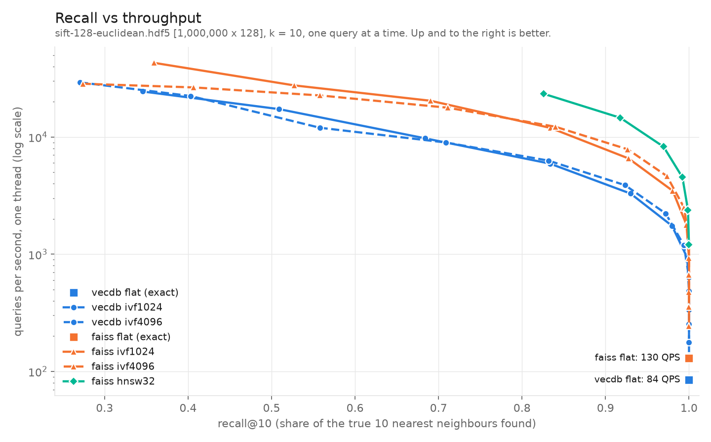
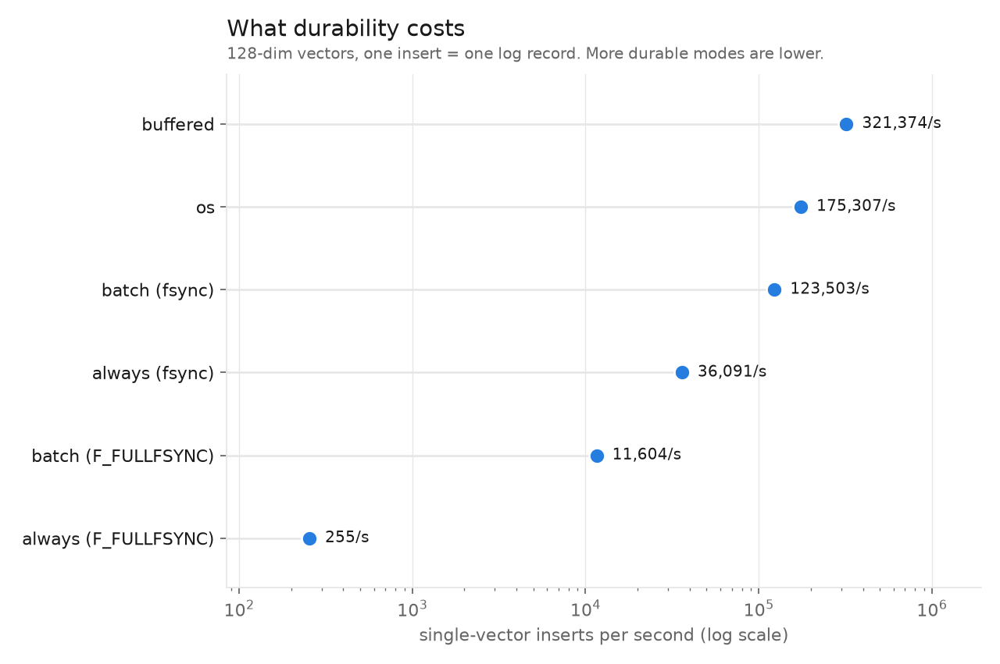
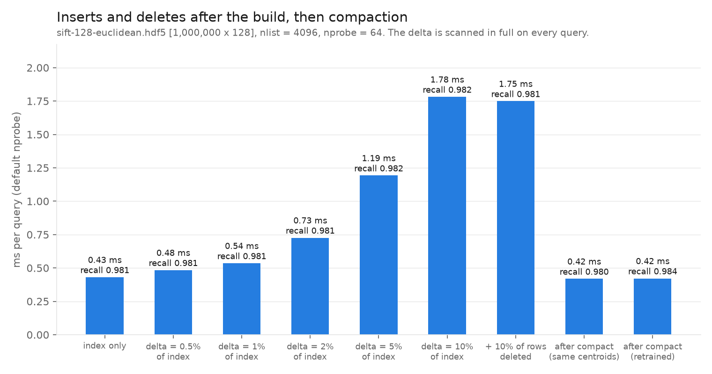

# Results

Machine: macOS-27.2.1-arm64-arm-64bit-Mach-O (arm64), 10 CPUs, Python 3.13.0, NumPy 2.5.5, BLAS accelerate unknown. Query timings use one thread.

## Search (sift-128-euclidean.hdf5 [1,000,000 x 128])

| system | recall >= 0.90 | recall >= 0.95 | recall >= 0.99 |
|---|---|---|---|
| vecdb flat | 84 QPS (11.84 ms), exact | same | same |
| vecdb ivf1024 | 3,289 QPS (0.30 ms, param 16) | 1,746 QPS (0.57 ms, param 32) | 931 QPS (1.07 ms, param 64) |
| vecdb ivf4096 | 3,880 QPS (0.26 ms, param 32) | 2,226 QPS (0.45 ms, param 64) | 1,194 QPS (0.84 ms, param 128) |
| faiss flat | 130 QPS (7.71 ms), exact | same | same |
| faiss ivf1024 | 6,559 QPS (0.15 ms, param 16) | 3,471 QPS (0.29 ms, param 32) | 1,780 QPS (0.56 ms, param 64) |
| faiss ivf4096 | 7,845 QPS (0.13 ms, param 32) | 4,634 QPS (0.22 ms, param 64) | 2,491 QPS (0.40 ms, param 128) |
| faiss hnsw32 | 14,579 QPS (0.07 ms, param 32) | 8,256 QPS (0.12 ms, param 64) | 4,528 QPS (0.22 ms, param 128) |

Our index build:

| index | k-means | assign + sort | list imbalance | index bytes per vector |
|---|---|---|---|---|
| vecdb ivf1024 | 0.8s | 1.1s | 1.20 | 4.5 |
| vecdb ivf4096 | 10.0s | 3.5s | 1.23 | 6.1 |

Full sweep of our index:

| index | nprobe | recall@10 | mean ms | p99 ms | QPS | rows scanned |
|---|---|---|---|---|---|---|
| vecdb ivf1024 | 1 | 0.3456 | 0.041 | 0.073 | 24,443 | 0.12% |
| vecdb ivf1024 | 2 | 0.5090 | 0.058 | 0.100 | 17,290 | 0.23% |
| vecdb ivf1024 | 4 | 0.6840 | 0.103 | 0.173 | 9,739 | 0.46% |
| vecdb ivf1024 | 8 | 0.8334 | 0.169 | 0.286 | 5,927 | 0.90% |
| vecdb ivf1024 | 16 | 0.9300 | 0.304 | 0.486 | 3,289 | 1.77% |
| vecdb ivf1024 | 32 | 0.9796 | 0.573 | 0.857 | 1,746 | 3.46% |
| vecdb ivf1024 | 64 | 0.9979 | 1.074 | 1.513 | 931 | 6.72% |
| vecdb ivf1024 | 128 | 0.9999 | 2.059 | 2.706 | 486 | 12.99% |
| vecdb ivf1024 | 256 | 1.0000 | 3.938 | 5.023 | 254 | 25.29% |
| vecdb ivf1024 | 512 | 1.0000 | 7.344 | 9.063 | 136 | 49.19% |
| vecdb ivf4096 | 1 | 0.2706 | 0.034 | 0.042 | 29,234 | 0.03% |
| vecdb ivf4096 | 2 | 0.4030 | 0.045 | 0.063 | 22,375 | 0.06% |
| vecdb ivf4096 | 4 | 0.5578 | 0.083 | 0.121 | 11,993 | 0.12% |
| vecdb ivf4096 | 8 | 0.7089 | 0.111 | 0.161 | 8,973 | 0.24% |
| vecdb ivf4096 | 16 | 0.8318 | 0.159 | 0.234 | 6,282 | 0.47% |
| vecdb ivf4096 | 32 | 0.9234 | 0.258 | 0.374 | 3,880 | 0.92% |
| vecdb ivf4096 | 64 | 0.9720 | 0.449 | 0.615 | 2,226 | 1.80% |
| vecdb ivf4096 | 128 | 0.9938 | 0.837 | 1.107 | 1,194 | 3.50% |
| vecdb ivf4096 | 256 | 1.0000 | 1.569 | 1.960 | 638 | 6.85% |
| vecdb ivf4096 | 512 | 1.0000 | 2.979 | 3.632 | 336 | 13.21% |
| vecdb ivf4096 | 1024 | 1.0000 | 5.643 | 6.546 | 177 | 25.41% |

## Write throughput by sync mode

| mode | sync call | inserts/s | microseconds per insert |
|---|---|---|---|
| buffered | none | 321,374 | 3.1 |
| os | none | 175,307 | 5.7 |
| batch | fsync | 123,503 | 8.1 |
| always | fsync | 36,091 | 27.7 |
| batch | F_FULLFSYNC | 11,604 | 86.2 |
| always | F_FULLFSYNC | 255 | 3921.0 |

## Recovery time

| scenario | vectors | seconds | log records replayed |
|---|---|---|---|
| log only, no snapshot, no index | 1000000 | 0.25 | 20 |
| rebuild the index from scratch (k-means + assign) | 1000000 | 13.79 |  |
| snapshot with index, empty log | 1000000 | 0.10 | 0 |
| snapshot with index + 100,000 log records | 1100000 | 0.44 | 100000 |

## Crash test (SIGKILL during inserts)

| mode | acknowledged | recovered | lost acknowledged | torn bytes |
|---|---|---|---|---|
| buffered | 219053 | 219008 | 45 | 0 |
| buffered | 206137 | 206080 | 57 | 0 |
| buffered | 158148 | 158144 | 4 | 0 |
| os | 95752 | 95753 | 0 | 0 |
| os | 121991 | 121991 | 0 | 0 |
| os | 111147 | 111147 | 0 | 0 |
| batch | 134333 | 134334 | 0 | 0 |
| batch | 91046 | 91046 | 0 | 0 |
| batch | 105280 | 105281 | 0 | 0 |
| always | 36682 | 36683 | 0 | 0 |
| always | 46057 | 46057 | 0 | 0 |
| always | 33142 | 33143 | 0 | 0 |

## Changes after the build

| stage | ms/query | recall@10 | delta rows | dead rows | stage took |
|---|---|---|---|---|---|
| index only | 0.430 | 0.9805 | 0 | 0 |  |
| delta = 0.5% of index | 0.484 | 0.9810 | 4500 | 0 |  |
| delta = 1% of index | 0.535 | 0.9810 | 9000 | 0 |  |
| delta = 2% of index | 0.726 | 0.9810 | 18000 | 0 |  |
| delta = 5% of index | 1.192 | 0.9815 | 45000 | 0 |  |
| delta = 10% of index | 1.781 | 0.9820 | 90000 | 0 |  |
| + 10% of indexed rows deleted | 1.749 | 0.9810 | 90000 | 90000 | 0.32s |
| after compact (same centroids) | 0.418 | 0.9800 | 0 | 0 | 0.64s |
| after compact (retrained) | 0.421 | 0.9840 | 0 | 0 | 13.46s |
